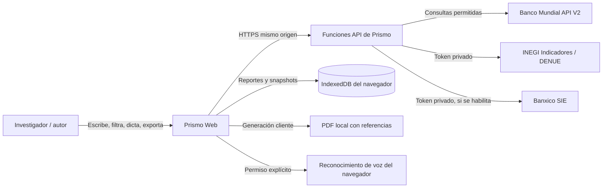
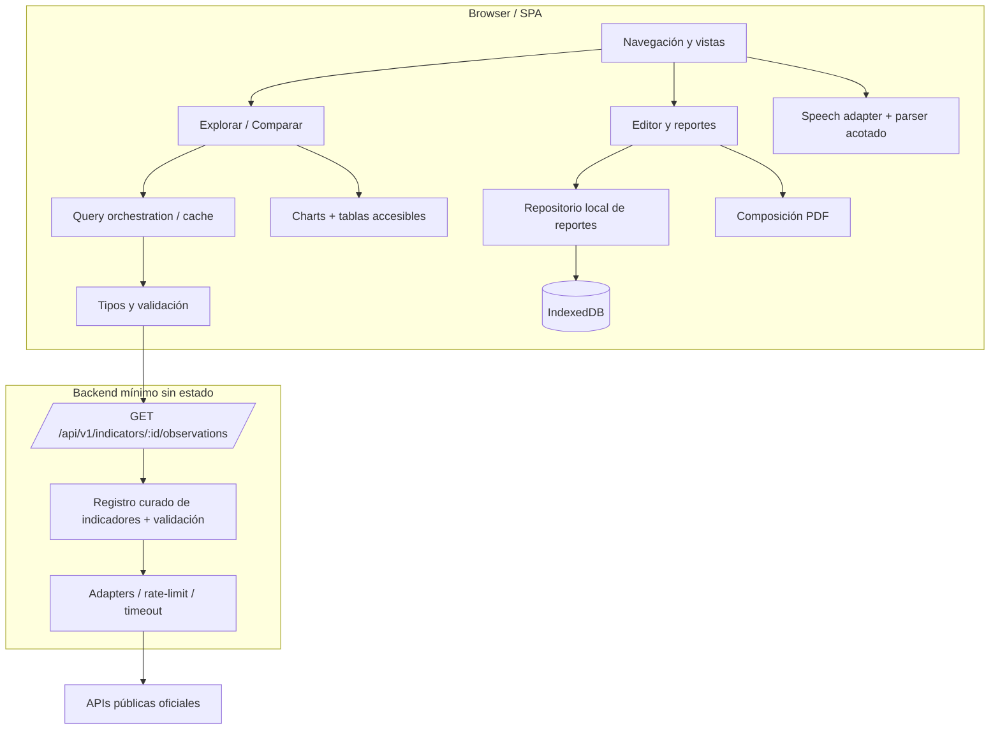
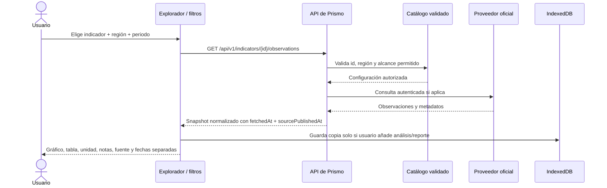
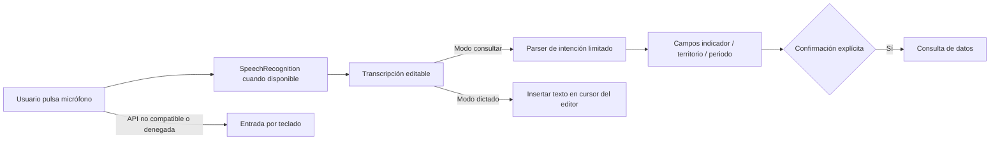

# Prismo — System Design y Arquitectura de Software

> Propuesta de origen. El backend implementado vive en `prismo-api/`, separado del frontend `prismo/`. Consulta [la arquitectura vigente](../documentation/ARQUITECTURA_Y_OPERACION.md).

**Documento:** ARQ-PRISMO-001 · **Versión:** 1.0 · **Fecha:** 12/11/2026  
**Estado:** propuesta técnica implementable, sujeta a validación con el primer corte vertical.  
**Fuentes internas:** `PRISMO_SRS_v1.0.md`, `PRISMO_PRODUCT_UX_v1.2.md`. **Decisiones de librerías:** `PRISMO_TECH_STACK_v1.0.md`.

## 1. Visión aprobada y problema técnico

Prismo es una **web responsive** que reduce la carga de buscar estadísticas oficiales una por una, comparar series, generar dashboards y transcribir referencias para que estudiantes, investigadores, divulgadores y organizaciones dediquen más tiempo a **escribir reportes sobre cambios e impactos sociales y ambientales**. Admite usos económicos y financieros a través de sus diez categorías. La persona decide y escribe sus propias conclusiones (**Enfoque A**). Las consultas por voz se transcriben y se validan antes de ejecutarse. El nombre del producto es **Prismo**; su isotipo `assets/PrismoLogo.png` no lleva texto.

**Regla de confianza:** «Consultado hoy» indica cuándo se solicitó la fuente; «último dato publicado» indica el periodo observado real y puede ser de meses o años anteriores. Nunca inventar cifras, fechas, indicadores, coberturas ni causalidad.

## 2. Alcance, límites y ruta corta

| Nivel | Entregable obligatorio | Fuera de alcance |
|---|---|---|
| Corte vertical 0 (demostración) | Una serie del Banco Mundial → filtros → gráfica/tabla → insertar al editor → guardar localmente → generar PDF con referencia; mismo flujo por texto. | Diez categorías terminadas, backend propio de usuarios, IA generativa. |
| Corte vertical 1 | Dos fuentes reales (Banco Mundial + un indicador INEGI verificado), comparación compatible, reconocimiento de voz progresivo, estado de errores, PDF revisable. | Sincronización multiusuario, dashboards libres sin catálogo. |
| V1 según SRS | Exactamente diez categorías visibles y **al menos una consulta oficial verificada por categoría**; editor, voz, referencias y PDF funcionales, sin cuenta obligatoria. | Ingesta universal de internet, inferencias causales, informes escritos por LLM, colaboración en vivo. |

La primera demo no equivale a la V1. La activación de una categoría depende de disponibilidad probada de sus indicadores. Para una demostración previa puede existir una sección anunciada como «próxima», pero la condición de SRS V1 exige diez operativas.

## 3. Atributos de calidad y requisitos que dominan la arquitectura

- **Trazabilidad (RF-007/011/020/034/041/046):** metadatos verificables viajan de API a PDF; almacenar instantánea de observaciones y filtros de cada bloque.
- **Integridad (RF-009/010/016-018, RB-01 a RB-11):** valor ausente es `null`, no `0`; comparaciones con validación previa; fechas y frecuencia explícitas.
- **Continuidad (RF-037/038/054):** guardar borradores en el mismo navegador; una API caída no borra editor ni instantáneas.
- **Accesibilidad (RF-021/023/049/050):** alternativas tabulares, modo móvil, teclado, voz opcional.
- **Control editorial (RF-026/029/030/040/043):** texto reconocido editable; no ejecución automática; no redactar conclusiones como hechos.
- **Seguridad y costo:** ocultar tokens de INEGI/Banxico/DENUE detrás de rutas propias; validar catálogo/filtros; cero base de datos de usuarios en MVP.

## 4. Vista de contexto (C4 nivel 1)



**Límites de confianza:** proveedor → servidor Prismo → cliente → documento local; el navegador nunca recibe credenciales de proveedor ni se confía en datos de filtros sin validación. El resultado estadístico puede ser público; el texto del reporte permanece local en el dispositivo del usuario salvo exportación o decisión explícita posterior.

## 5. Vista de contenedores (C4 nivel 2)



Se favorece una **SPA modular** y un **BFF mínimo serverless**. No separar en microservicios, no levantar una base de datos remota por anticipado y no hacer scraping generalista. Las categorías e IDs autorizados viven en un catálogo de versión controlada.

## 6. Módulos y responsabilidades

| Módulo | Responsabilidad | No debe hacer |
|---|---|---|
| `catalog` | Definir diez categorías, indicadores soportados, geografía, frecuencia, notas, fuente y estado de verificación. | Descubrir IDs por coincidencias sin verificar y exponer indicadores inventados. |
| `providers` | Conectar al Banco Mundial, INEGI y después Banxico/DENUE/archivos oficiales curados. | Transformar definiciones metodológicas sin documentar. |
| `normalize` | Convertir respuestas heterogéneas a un contrato único, conservar faltantes y origen. | Rellenar valores ausentes con cero. |
| `compare` | Verificar unidades, conceptos, frecuencia, fechas y territorio; devolver razones si no se puede. | Superponer series incompatibles por conveniencia visual. |
| `visualizations` | Crear especificaciones de chart reproducibles y tablas accesibles. | Fijar solo píxeles sin exportación o fuente. |
| `reports` | Crear/editar/duplicar/borrar reportes y autosave local. | Enviar texto del usuario al servidor por defecto. |
| `editor` | Manejar texto enriquecido y nodos de gráfica enlazados a instantáneas. | Tomar decisiones editoriales por el usuario. |
| `export` | Convertir modelo documental a PDF, preservar gráficas, referencias y paginación. | Dar éxito si faltan bloques. |
| `speech` | Convertir voz a texto y, opcionalmente, extraer intención en vocabulario validado. | Ejecutar comandos ambiguos o redactar interpretaciones falsas. |

## 7. Modelo de dominio normalizado

```ts
export type ProviderId = 'world-bank' | 'inegi-indicators' | 'inegi-denue' | 'banxico' | 'official-curated';
export type Frequency = 'daily' | 'monthly' | 'quarterly' | 'annual' | 'census' | 'irregular';
export type ValueStatus = 'official' | 'preliminary' | 'estimated' | 'revised' | 'missing' | 'unknown';

export interface IndicatorDefinition {
  id: string;                 // id interno, inmutable, p.ej. 'wb-co2-per-capita'
  provider: ProviderId;
  providerIndicatorId: string;
  categoryId: 'CAT-01'|'CAT-02'|'CAT-03'|'CAT-04'|'CAT-05'|'CAT-06'|'CAT-07'|'CAT-08'|'CAT-09'|'CAT-10';
  label: string; description: string; unit: string; frequency: Frequency;
  supportedGeographies: string[]; // id del catálogo, NO cualquier string del usuario
  sourcePage: string; methodologyUrl?: string; attribution?: string;
  verifiedAt: string;         // ISO datetime del control de catálogo
  isEnabled: boolean;
}
export interface Observation {
  period: string;            // preserva calendario/frecuencia fuente, e.g. '2024', '2024-Q3'
  geographyId: string;
  value: number | null;      // null es ausente, NUNCA se transforma en cero
  status: ValueStatus;
  note?: string;
}
export interface DatasetSnapshot {
  snapshotId: string; indicatorId: string; provider: ProviderId;
  query: { geographies: string[]; from?: string; to?: string };
  observations: Observation[];
  unit: string; frequency: Frequency; methodologyKey?: string;
  fetchedAt: string;           // cuándo consultó Prismo
  sourcePublishedAt?: string;   // actualización declarada por la fuente, si la existe
  latestObservationPeriod?: string; // período real más reciente con dato
  sourceUrl: string; attribution?: string; catalogVersion: string;
  cacheState: 'fresh'|'cached'|'stale';
}
export type VisualizationKind = 'line' | 'bar' | 'kpi' | 'table';
export interface ChartSpec {
  id: string; kind: VisualizationKind; title: string;
  snapshotIds: string[]; selectedGeographies: string[];
  visiblePeriods: string[]; annotation?: string;
}
export interface ReportBlockReference {
  chartId: string; snapshots: DatasetSnapshot[]; // frozen, para reproducibilidad
}
export interface ReportDocument {
  reportId: string; schemaVersion: 1; title: string;
  author?: string; createdAt: string; updatedAt: string;
  editorJson: unknown;               // JSON estructurado del editor, validado en fronteras
  sources: DatasetSnapshot[];        // referencias y datos congelados por bloque
}
```

**Nota:** contratos orientativos. El catálogo debe precisar `methodologyKey`, unidades transformadas, clave geográfica del proveedor, nomenclaturas y temporalidad antes de habilitar cada indicador. Un `ReportDocument` se versiona para migración local; no almacenar únicamente HTML como fuente de verdad.

## 8. Consulta, normalización y procedencia



- No introducir tokens en `VITE_*`, en código cliente ni en URLs de navegador cuando puedan exponer credenciales.
- La API no aceptará URLs arbitrarias (evita *open proxy/SSRF*). Cada `indicatorId` mapea a un origen y patrón permitido.
- Validar entradas y respuestas con esquemas, `AbortSignal`/timeouts, errores tipados y límites de filas; caché y reintentos prudentes.
- No guardar el texto del reporte en logs de servidor. Loguear únicamente errores técnicos y métricas agregadas, sin audio ni documentos.
- Distinguir `sourcePublishedAt`, `fetchedAt`, `latestObservationPeriod` y `cacheState` en UI y PDF.
- Si el proveedor no ofrece fecha de publicación, **mostrar «fecha no informada»**, nunca inferirla de `fetchedAt`.
- Si la fuente solo publica un dato anual, la UI debe decir «último año disponible», incluso si consultó hoy.

## 9. API interna estable propuesta

Base: `/api/v1`. Especificación conceptual, a implementar con el backend elegido en el documento de stack.

| Método / ruta | Propósito | Respuesta |
|---|---|---|
| `GET /api/v1/health` | Verificar disponibilidad básica. | `{status:'ok', version:'1'}` |
| `GET /api/v1/indicators/:id/observations?geographies=MEX,COL&from=2015&to=2025` | Traer datos de indicador **previamente autorizado**. | `DatasetSnapshot` sin credenciales |
| `GET /api/v1/indicators/:id/meta` | Ver ficha y soporte de filtros. | `IndicatorDefinition` pública |

El catálogo de 10 categorías también puede servirse como un archivo estático versionado (`catalog.v1.json`); no hace falta inventar un endpoint si funciona mejor offline.

**Errores:** `INVALID_FILTER` (400), `INDICATOR_NOT_AVAILABLE` (404/422), `UPSTREAM_UNAVAILABLE` (503), `UPSTREAM_TIMEOUT` (504), `RATE_LIMITED` (429), `NO_OBSERVATIONS` (200 con lista vacía y estado `empty`). Mensajes para personas, códigos para programa. Nunca exponer tokens en cuerpo, excepciones o logs.

## 10. Comparabilidad: reglas de negocio ejecutables

Una comparación directa solo es válida si **definición y unidad** equivalentes, misma **frecuencia**, geografía compatible, periodos disponibles y estatus metodológico revisado. En caso contrario devolver `ComparisonDecision` con `allowed:false` y razones: `DIFFERENT_UNITS`, `FREQUENCY_MISMATCH`, `DEFINITION_MISMATCH`, `NO_OVERLAPPING_PERIODS`, `MIXED_TERRITORIAL_LEVELS`, `METHODOLOGY_UNVERIFIED`.

```ts
interface ComparisonDecision { allowed: boolean; reasons: string[]; compatiblePeriods: string[] }
```

Un mismo indicador en dos países puede dibujarse conjuntamente si definición/unidad/frecuencia coinciden; dos indicadores económicos distintos podrían mostrarse **en paneles separados** con etiquetas, sin implicar causalidad. No interpolar, no asumir cero, no sumar series de distinta unidad.

## 11. Editor, snapshots y bibliografía

- Editor con estructura JSON y **nodo de visualización** que referencia un `ChartSpec` y un `DatasetSnapshot` congelado.
- Al añadir al reporte: copiar datos del resultado actual, `indicatorId`, filtros, fuente, fechas y estado; no solo una captura de pantalla.
- El texto del autor es editable y no se atribuye automáticamente al INEGI/Banco Mundial.
- Una gráfica retirada elimina su referencia del reporte si no queda ningún otro bloque que la use; bibliografía sin duplicados pero citas por bloque.
- Autosave **debounced** y estado visible: guardando, guardado local, error de guardado, cambios sin guardar.
- Informe sin cuenta → almacenamiento de IndexedDB vinculado a navegador y origen. Limpiar datos del navegador puede destruir borradores. Ofrecer exportación del reporte a JSON como respaldo en evolución cercana si el MVP lo permite.
- Los datos congelados del PDF conservan fecha, cobertura y fuente de la consulta original. No se actualizan silenciosamente al reabrir un borrador.

## 12. Estrategia PDF: una única fuente documental

Pipeline: `ReportDocument` → conversor controlado de nodos del editor → bloques de PDF (párrafos, tablas, títulos, chart) → bibliografía → descargar. Preferir generación PDF **del lado cliente** para minimizar costos y no transferir contenido privado al servidor. Preparar visualizaciones desde configuración/datos y exportar como SVG válido, con conversión a formato compatible si alguna gráfica no se renderiza correctamente. La salida debe incluir texto seleccionable; evitar rasterizar páginas enteras como imagen.

**Criterio bloqueante:** el PDF debe pasar pruebas de dos o más páginas, tablas anchas, caracteres españoles (acentos, ñ), links, fuentes duplicadas, datos faltantes, series múltiples y ausencia de un gráfico. Si falla un chart, mostrar error y permitir reintentar; no descargar un informe marcado como íntegro.

## 13. Voz como mejora progresiva



La disponibilidad depende de navegador/permisos y algunos servicios pueden procesar audio remotamente. Mostrar explicación de privacidad; nunca afirmar que es 100% offline. No usar un LLM para inventar filtros o redactar análisis en V1. Parsear solo intenciones cubiertas por el catálogo y requerir confirmación.

## 14. Diez categorías: registro de conectores planeado

| SRS | Categoría | Fuente y camino tentativo | Validación antes de activar |
|---|---|---|---|
| CAT-01 | Inflación | INEGI indicadores INPC | ID oficial, unidad %, frecuencia y cobertura correctas |
| CAT-02 | Actividad económica | INEGI/Banco Mundial PIB | Definición PIB nominal/real y frecuencia explícita |
| CAT-03 | Empleo | INEGI indicadores laborales | Serie, metodología/territorio ENOE verificados |
| CAT-04 | Ingreso y gasto de hogares | ENIGH: tabulados oficiales curados si no hay endpoint equivalente | Año y unidad de análisis/representatividad claros; no simular API |
| CAT-05 | Tasas/tipo de cambio | Banxico SIE | ID real, token y condiciones del endpoint |
| CAT-06 | Empresas | INEGI DENUE, método Cuantificar | Conteos por actividad y localidad; token/alcance confirmado |
| CAT-07 | Población | Banco Mundial/INEGI | Series internacionales o censales con periodo real |
| CAT-08 | Vivienda/servicios | INEGI/Banco Mundial | No confundir definición de acceso a agua y servicios de vivienda |
| CAT-09 | Educación | INEGI/Banco Mundial | Indicadores disponibles y grados/edades comparables |
| CAT-10 | Ambiente | Banco Mundial (CO₂, agua, etc.) | Unidad por habitante vs total y años disponibles |

**Fase de comprobación de conectores:** cada categoría tendrá una ficha fuente con `providerIndicatorId`, URL oficial, licencia/atribución, unidad, frecuencia, regiones, método de extracción (API directa, API por BFF o archivo oficial versionado) y un caso de prueba de integración. **Sin ficha validada, no se declara terminada.**

## 15. Seguridad, privacidad y resiliencia

- Tokens solo en secretos del servidor; `CORS` en mismo origen; encabezados de seguridad y CSP progresivos; dependencias auditadas.
- Serverless BFF: whitelist de IDs y destinos, timeout, topes de paginación y rate limiting si se expone públicamente; nunca proxy abierto.
- Proveedor caído: UI muestra aviso y alternativa de último snapshot **etiquetado**. Editor permanece accesible.
- Recuperación local: avisar si no se pudo guardar; mantener contenido visible y reintento; no prometer sincronización ni recuperación entre navegadores.
- Importación de HTML/texto en editor: sanear contenido; no interpretar HTML arbitrario de proveedor como confiable.
- Evitar enviar audio, texto o reportes a proveedores estadísticos. El navegador puede enviar audio al motor de voz según implementación; la interfaz debe aclararlo.
- Accesibilidad objetivo WCAG 2.2 AA para flujos críticos; pruebas con teclado, lector y móvil.

## 16. Registros de decisiones arquitectónicas (ADRs)

| ID | Decisión | Motivo | Condición de revisión |
|---|---|---|---|
| ADR-001 | Web SPA con módulos por dominio | Familiaridad del autor con React y entrega rápida | SEO intensivo o prerender exigido |
| ADR-002 | BFF serverless ligero | Tokens seguros, normalización, evitar CORS, misma entrada para fuentes | Carga y requisitos de integración crecen |
| ADR-003 | Almacenamiento local inicial | No registro/costo de DB, edición privada | Colaboración / múltiples dispositivos |
| ADR-004 | Catálogo curado | Trazabilidad y reglas de comparabilidad | Equipo de curación y decenas de nuevos indicadores |
| ADR-005 | Documento JSON y snapshots inmutables | Persistencia y exportación reproducible | Editor incompatible / migración validada |
| ADR-006 | PDF cliente con adaptador | Privacidad y costo | Fuentes/formatos avanzados exigen render de servidor |
| ADR-007 | SpeechRecognition + entrada manual | Voz sin cuota inicial y función no bloqueante | Compatibilidad insuficiente en usuarios reales |
| ADR-008 | Sin IA generativa en V1 | Enfoque A: autor responsable, precisión y presupuesto | Producto valida demanda de asistencia de escritura |

## 17. Estructura de carpetas propuesta

```text
prismo/
├─ AGENTS.md
├─ docs/                        # SRS, UX, arquitectura y stack aprobados
├─ public/PrismoLogo.png
├─ src/
│  ├─ app/                      # router, providers, composición
│  ├─ features/catalog/
│  ├─ features/explorer/
│  ├─ features/compare/
│  ├─ features/reports/
│  ├─ features/editor/
│  ├─ features/export/
│  ├─ features/speech/
│  ├─ shared/ui/                # componentes y design tokens
│  ├─ shared/lib/               # fechas, formateo, errores
│  └─ domain/                   # schemas y reglas puras
├─ functions/api/v1/            # backend Cloudflare Pages Functions
├─ tests/unit/
├─ tests/integration/
└─ tests/e2e/
```

`domain` no importa componentes React ni librerías de visualización. `providers` no altera por sí solo la interpretación del autor. `export` usa el mismo contrato de datos del explorador, sin reconsultar a la fuente por debajo.

## 18. QA, observabilidad y definición de terminado

**Unitarias:** convertir `'NA'` a `null`, coerción numérica con esquema, frecuencia/compatibilidad, parser de intenciones, deduplicación de bibliografía, formato y fechas.  
**Integración:** adaptador Banco Mundial, adaptador INEGI con fixture real anonimizado (sin token), errores 429/503/timeout, `CatalogValidator`, persistencia local y exportación PDF.  
**E2E:** consulta → gráfica con fuente → reporte → cerrar/reabrir → PDF; voz denegada → ingreso manual; incompatibilidad → bloqueo explicado; móvil 360 px; API caída durante edición.  
**QA fuente:** actualizar fixtures con observaciones oficiales y fecha; no volver a grabar una API fallida como éxito.  
**Observabilidad:** errores de conectores agregados, tiempos y estado (sin datos del documento), no analytics invasivo en el prototipo.

**DoD corte 0:** una fuente **real** verificada, gráfico y tabla, ficha de procedencia, editor con bloque de gráfica, IndexedDB, PDF con contenido seleccionable, test E2E y sin tokens en browser.  
**DoD V1:** diez categorías activas verificadas, RF imprescindibles del SRS, sin errores bloqueantes de integridad/citas, prueba de usabilidad y accesibilidad de flujos críticos.

## 19. Orden de implementación: verticales, no capas por separado

1. **Spike de factibilidad (medio día–un día):** probar en desarrollo una consulta Banco Mundial y el PDF mínimo desde un chart SVG; comprobar compatibilidad de librerías.
2. **Corte 0:** tema ambiental/social con indicador Banco Mundial, visualización y reporte PDF, datos reales y enlaces.
3. **Corte 1:** añadir INEGI y secretos BFF, parser de voz, comparación validada y autosave robusto.
4. **Expandir catálogo por capacidades:** incorporar y validar una consulta por cada categoría hasta 10. Ingresos/ENIGH y Banxico requieren comprobación específica.
5. **Pulido UX y fiabilidad:** móvil, teclado, casos vacíos, PDFs multipágina, tests E2E y guía de fuentes.

Se busca un prototipo **demostrable en pocos días de trabajo concentrado para un corte vertical**, no prometer que toda la V1 con diez categorías se complete al mismo ritmo. No iniciar registro, cloud DB, colaboración ni LLM sin cambio explícito de alcance.

## 20. Referencias de implementación verificadas el 12/11/2026

- API Banco Mundial V2 (sin clave): https://datahelpdesk.worldbank.org/knowledgebase/articles/889392
- API de indicadores INEGI (requiere token): https://www.inegi.org.mx/servicios/api-indicadores/
- API DENUE (requiere token): https://www.inegi.org.mx/servicios/api-denue/
- Banxico SIE (verificar serie y token): https://www.banxico.org.mx/SieAPIRest/swagger/index.html
- SpeechRecognition (compatibilidad parcial): https://developer.mozilla.org/en-US/docs/Web/API/SpeechRecognition
- Web accessibility: https://www.w3.org/TR/WCAG22/

**Exclusiones deliberadas:** no se investiga ni decide un dominio comercial ni disponibilidad legal del nombre. Revisiones visuales secundarias se harán después del prototipo, sin relajar integridad o accesibilidad.
